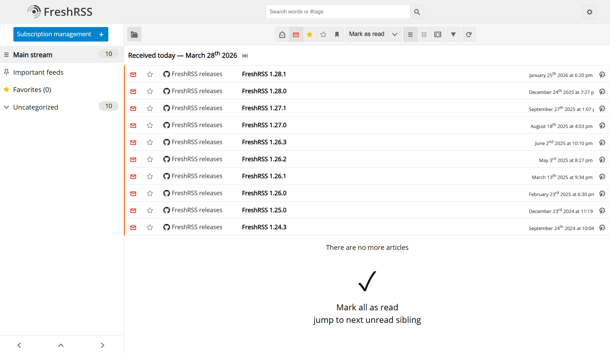
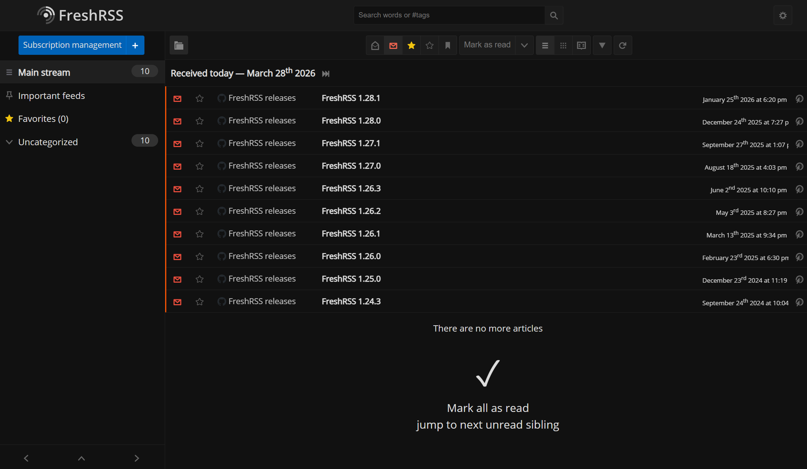
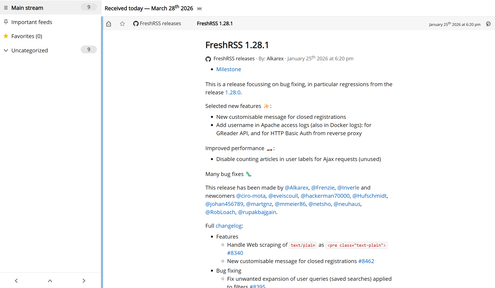
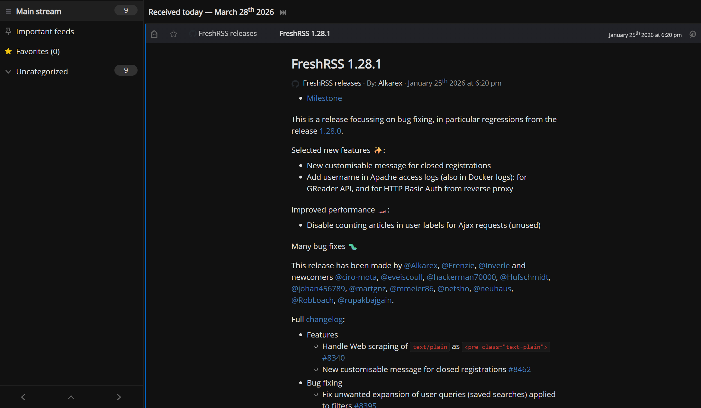
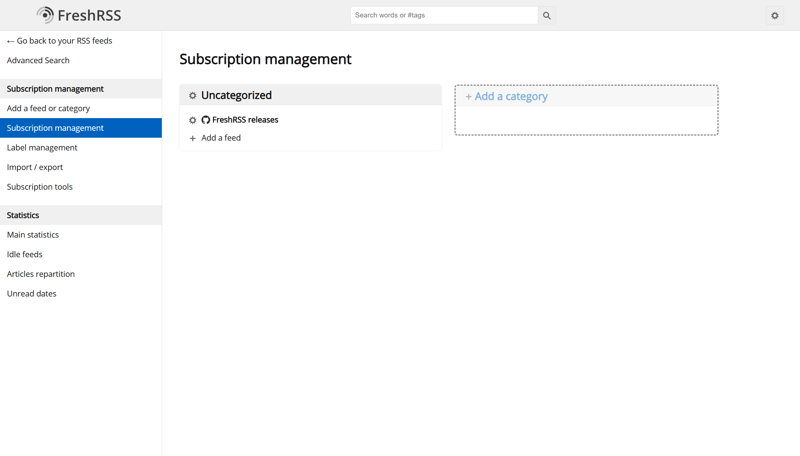
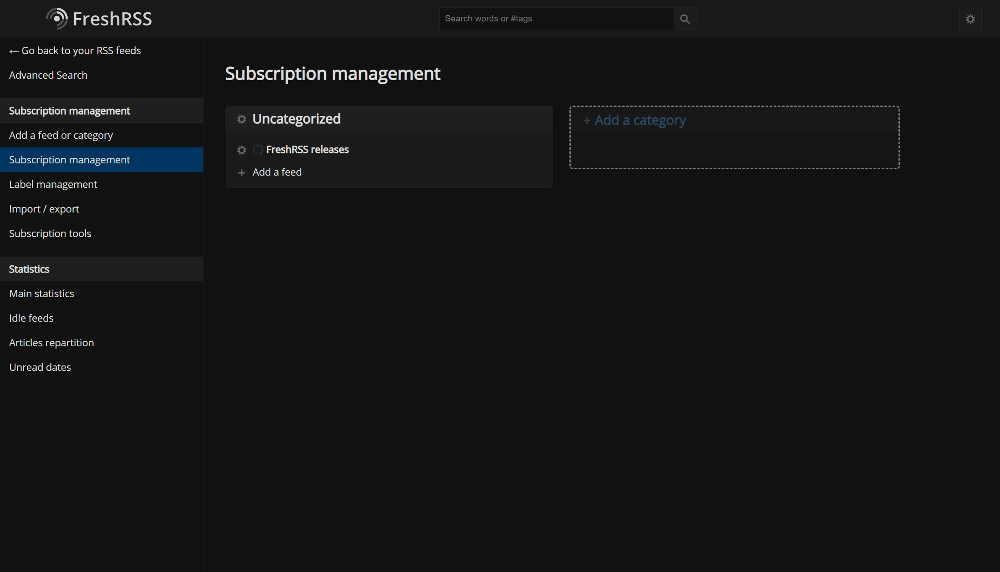
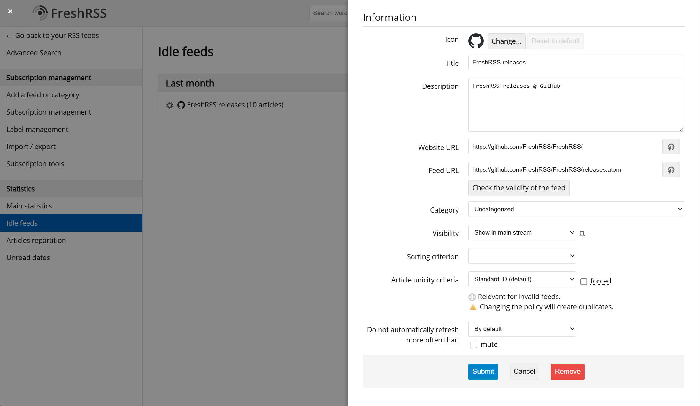
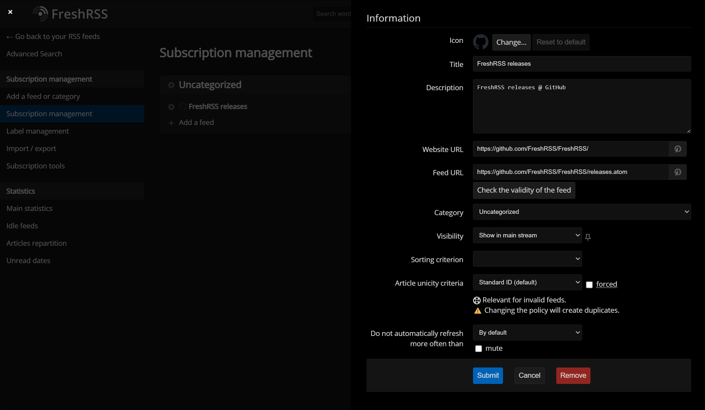
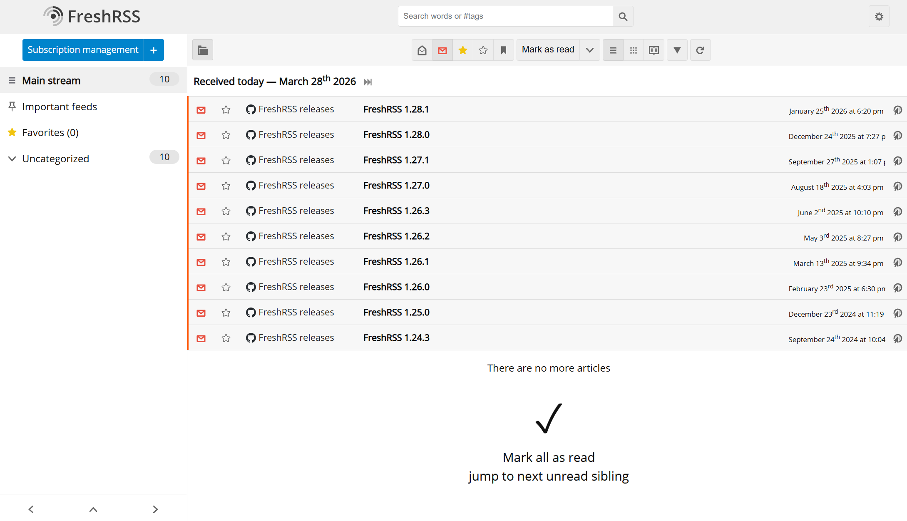
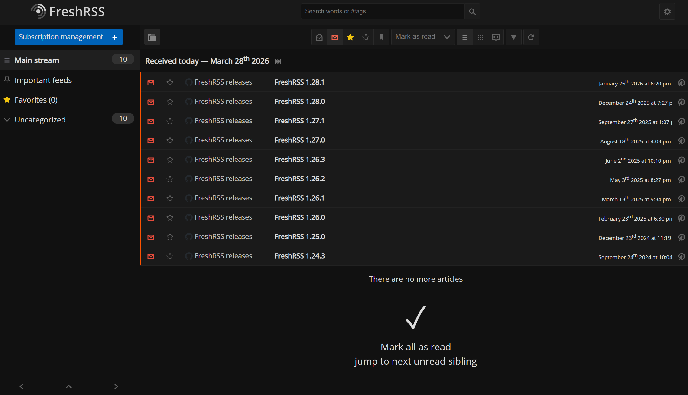

# FreshRSS Modern Origine Theme

[](https://freshrss.org/)
[](style.css)
[](#screenshots)
[](LICENSE)

A clean, modern custom CSS theme for [FreshRSS](https://freshrss.org/) designed to modernize and refine the default **Origine** theme. Supports both **Light** and **Dark** modes with seamless system switching, updated typography contrast, and sleek UI accents inspired by the Alternative Dark FreshRSS theme.

---

## ✨ Features

- 🌓 **Automatic Light & Dark Mode** – Fully supports `prefers-color-scheme` and FreshRSS's auto dark mode.
- 🎨 **Modern Minimalist UI** – Clean flat buttons, borderless shadows, subtle rounded thumbnails (`3px`), and toned-down logos.
- 📰 **Refined Reading Experience** – Balanced contrast, customized link highlights, and crisp feed item titles.
- 📱 **Mobile Optimized** – Streamlined header spacing and dropdown borders for viewports under 840px.
- 🎛️ **Customizable Unread Highlighting** – Easily toggle between flat unread headers or tinted card highlights.
- ⚡ **Drop-in User CSS** – No file modifications or server restarts required; apply instantly via the FreshRSS User CSS extension.

---

## 📸 Screenshots

### Main Feed View
| Light Mode | Dark Mode |
| :---: | :---: |
|  |  |

### Article View
| Light Mode | Dark Mode |
| :---: | :---: |
|  |  |

### Subscription Management
| Light Mode | Dark Mode |
| :---: | :---: |
|  |  |

### Feed Options
| Light Mode | Dark Mode |
| :---: | :---: |
|  |  |

### Optional: Unread Article Background Highlighting
| Light Mode | Dark Mode |
| :---: | :---: |
|  |  |

---

## 🚀 Installation & Usage

### Prerequisites
1. FreshRSS installed and running.
2. Ensure your active FreshRSS theme is set to **Origine** (**Settings** ⚙️ > **Display** > **Theme** > *Origine*).

### Applying via User CSS Extension
1. Go to **Settings** (⚙️) > **Extensions**.
2. Enable the **User CSS** (`xExtension-UserCSS`) extension.
3. Click the **Configure** (⚙️ / manage) icon next to the toggle button.
4. Open [`style.css`](style.css) in this repository and copy its entire contents.
5. Paste the CSS code into the User CSS configuration textarea.
6. Click **Submit** / **Save**.

---

## ⚙️ Customization

### Enable Unread Article Background Color
By default, unread articles use a subtle, transparent header background. If you prefer unread articles to stand out with a dedicated background color (as shown in the [optional screenshots](#optional-unread-article-background-highlighting)):

Delete or comment out the following lines at the bottom of [`style.css`](style.css):

```css
/* For enable not read background color remove this. */
.flux.not_read .flux_header {
    background-color: unset;
}
```

---

## 🤝 Contributing

Contributions, feature requests, and suggestions are welcome! Feel free to open an issue or submit a pull request.

---

## 📄 License

This project is licensed under the [GNU General Public License v3.0](LICENSE).
